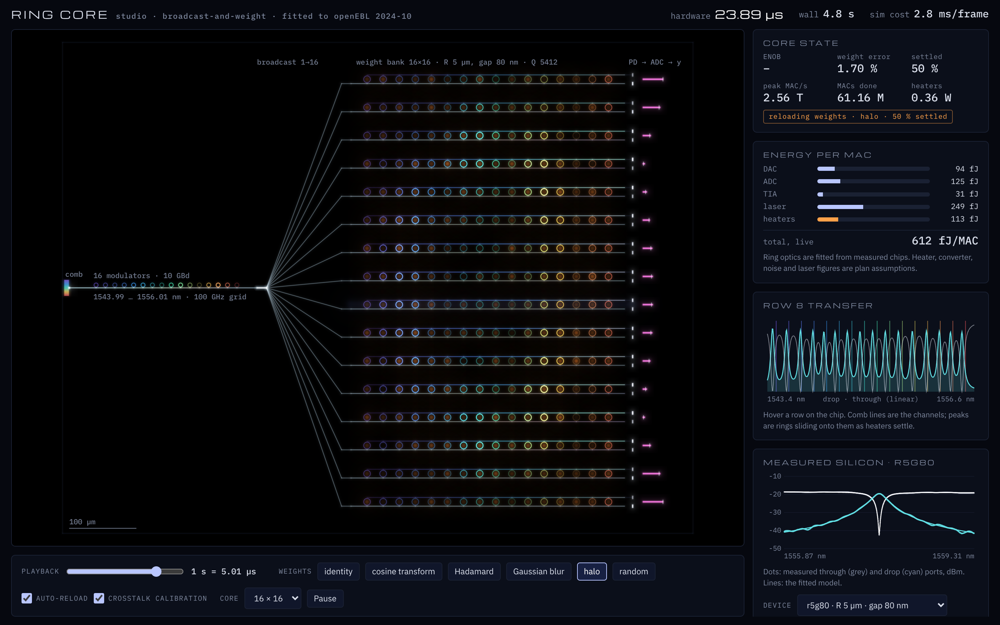

# studio

A photonic design studio, starting from one closed loop:

```
measured silicon ──► fitted ring physics ──► process model ──► predicts unseen devices
   (8 chips, 39            (Rust TMM,          (coupling vs gap,      (leave-one-out: ≤ 7.5 %)
    resonances)             LM fitter)          loss, group index)
                                   │
                                   └──► live simulator of a ring weight-bank core
                                        (femtosecond clock, energy and precision ledgers)
```



The measured data is the SiEPIC openEBL 2024-10 run: eight double-bus rings
(radius 3/5/10 µm, gap 70–110 nm) made by Applied Nanotools on 220 nm SOI
and measured by SiEPIC's automated test station. It is bundled in
`data/openEBL-2024-10/` under its MIT licence, with sources listed.

## Run it

```sh
cargo run --release                       # fit report, leave-one-out check, predictions
cargo run --release -- core               # core accuracy / energy / simulator speed (CPU)
cargo run --release -- gpu                # verify the wgpu kernel against its f64 twin; GPU throughput
cargo run --release -- econ               # first-principles cost / energy vs NVIDIA, AMD, Intel
cargo run --release --example patterns    # calibration quality per weight pattern
cargo test --release                      # 13 unit + 5 acceptance + 1 GPU test

./build.sh                                # browser view → web/pkg (needs wasm-bindgen-cli 0.2.129)
WEB_ROOT=studio/web node server.mjs       # from the repo root, then http://localhost:8080
```

The browser view parses and fits all 39 measured resonances in the tab at
start-up, builds the core from the fitted process model, and draws the
core's own state every frame.

## Results (step 1 acceptance)

**Fit against measured spectra.** Each resonance is fitted jointly on the
through and drop ports, in dB, with a symmetric add-drop transfer-matrix
model.

| | Result | Limit |
|---|---|---|
| All 39 resonances | 37 under 1 dB RMS; worst 1.47 dB | 1 dB → **fails strictly** |
| 31 SNR-qualified resonances (drop peak ≥ 23 dB above the detector noise ceiling) | worst 0.79 dB | 1 dB → **passes** |

The excluded resonances sit at the grating-coupler band edges (1521 and
1576 nm). There the drop signal is about 20 dB above noise, and a ≈ 0.25 nm
interference fringe from stray reflections in the measurement path rides on
its wings. The ring model doesn't include that fringe. Modelling it as
coherent stray light is the next model upgrade.

**Prediction.** For each device, the coupling-vs-gap law and the loss are
learned *without* that device, then used to predict its loaded Q:

| held out | r10g80 | r10g90 | r10g100 | r10g110 | r5g70 | r5g80 | r5g90 |
|---|---|---|---|---|---|---|---|
| error | +2.6 % | −1.2 % | −0.4 % | +2.2 % | +7.5 % | −0.8 % | +3.1 % |

The worst error is 7.5 % against a 15 % limit, so this **passes**.

**Process model (all eight devices).**

- **Group index:** 4.185 ± 0.004.
- **Coupling:** κ² halves every 36–39 nm of gap.
- **Propagation loss:**
  - 3.8 dB/cm at R = 10 µm
  - 7.3 dB/cm at R = 5 µm
  - 19.6 dB/cm at R = 3 µm, where bend loss shows up

**Pre-registered predictions** for devices not yet made (1550 nm), to check
against a future openEBL run:

| device | Q_L | FWHM | through extinction |
|---|---|---|---|
| r10g120 | 13 099 | 14.8 GHz | 23.4 dB |
| r10g130 | 15 475 | 12.5 GHz | 22.0 dB |
| r5g100 | 7 786 | 24.8 GHz | 22.2 dB |
| r5g110 | 9 294 | 20.8 GHz | 20.7 dB |
| r3g80 | 5 249 | 36.8 GHz | 17.1 dB |

**Core simulator** (rings from the process model; random weights; 100 000
symbols, all computed):

| core | ring | channels per FSR | calibration | weight error | ENOB | heaters | energy |
|---|---|---|---|---|---|---|---|
| 16×16 | r5g80 | 22 | off | 40.9 % | 0.6 | 0.48 W | 688 fJ/MAC |
| 16×16 | r5g80 | 22 | on | 0.00 % | **5.7** | 0.41 W | 660 fJ/MAC |
| 32×32 | r3g70 | 38 | on | 0.31 % | **5.5** | 1.58 W | 404 fJ/MAC |
| 64×64 | r3g70 | 38 | on | 29.3 % | 1.7 | 5.50 W | 259 fJ/MAC |

What the table shows:

- **Calibration is not optional.** Without it, neighbouring rings' tails and
  heater crosstalk destroy the weights.
- **64 channels fail on their own physics:** only 38 fit in one free spectral
  range, so rings alias onto other channels. Nothing in the simulator was told
  to fail there.
- **Energy:** heaters are the largest term. Converter energy per MAC falls as
  the core grows, as in docs/photonic/PLAN.md §6.

## GPU path (wgpu)

`src/gpu.rs` computes every symbol on the GPU in one WGSL kernel:
workload generation, effective-weight dot products, receiver noise, ADC,
weight-mapping correction and error accumulation. Up to 4 M symbols go in
each dispatch. It runs on Vulkan, Metal or DX12 natively, and on WebGPU in
the browser, where the page shows "GPU · 100 % of symbols". Without WebGPU
it falls back to CPU sampling.

`cpu_twin` replays the same arithmetic in f64 with the same hash RNG.
Measured agreement at 16×16, 32×32 and 64×64, with noise on and off:

- **ENOB:** within 0.00001 bits.
- **Final outputs:** identical (0 LSB difference).
- **Against the original CPU core path:** 5.708 vs 5.707 bits over 100 000
  symbols.

This container has no GPU, so the throughput measured here is on llvmpipe
(Mesa's software Vulkan): 2.4 M symbols/s at 16×16, already 4× the CPU path.
Run `cargo run --release -- gpu` on real hardware to get its numbers.

## Economics

`src/econ.rs` reduces every optical engine to energy per MAC ≈
E_in/fan-out + E_out/fan-in + light + static + memory. It then compares
cost to build, 3-year TCO, manufacturing energy and the idiot index
against H100, B200, MI300X and Gaudi 3. Findings are in
[docs/photonic/FIRST_PRINCIPLES.md](../docs/photonic/FIRST_PRINCIPLES.md).

## What is fitted and what is assumed

- **Fitted from measured silicon:** ring self-coupling, loss, group index and
  resonance positions, plus the coupling-vs-gap law.
- **Assumed** (plan assumptions, Appendix A of PLAN.md):
  - thermal: 70 pm/K, τ = 5 µs, 0.25 nm/mW, 8 % neighbour crosstalk
  - fab spread: 0.10 nm intra-die
  - receiver noise
  - converter and laser energies
- **Weighting window:** ring detuning stops at 0.38 of the channel spacing, and
  logical ±1 uses 75 % of the reachable weight range. The rest is headroom for
  cancelling crosstalk (`cargo run --example patterns` shows why).

## Known limits

- **Calibration is idealised.** It uses the simulator's exact knowledge of
  each ring's fabricated offset. Real hardware has to measure that, which is
  what the plan's live calibration mechanism (N3) is for. The ENOB figures
  above are therefore upper bounds on what the control loop can reach.
- **The ring model is single-mode and steady-state.** It has no backscatter
  splitting and no in-ring dynamics; the simulator's L2 symbol level assumes
  100 ps symbols ≫ 6 ps photon lifetime.
- **Thermal is a first-order lumped model** with nearest-neighbour crosstalk.
- **The layout is to scale but schematic.** Propagation delays come from its
  path lengths.
- **The simulator is CPU-only and single-threaded:** ≈ 1.7 µs per symbol at
  16×16. The WebGPU path in the plan is what makes L2 fast.
- **The browser view draws exposure-averaged light** (one frame's worth of
  symbols) at normal playback. Below about 6 ns of hardware time per wall
  second it switches to per-symbol wavefronts.

## Layout

```
src/ring.rs      add-drop ring transfer-matrix model + inverse helpers (simulator)
src/matfile.rs   MATLAB level-5 reader, zlib via miniz_oxide (measurement ingest)
src/measure.rs   foundry spectra; bundled openEBL rings; noise ceiling; peak finding
src/fit.rs       Levenberg–Marquardt; per-resonance joint through/drop fits (optimiser)
src/process.rs   coupling-vs-gap law, loss, n_g; leave-one-out prediction
src/core.rs      broadcast-and-weight core, femtosecond clock, ledgers, layout
src/web.rs       WebGL2 glow renderer + Canvas 2D plots reading Core directly (wasm only)
src/main.rs      `studio-cli`: fit report and core benchmark
tests/           acceptance tests with the step-1 thresholds
web/index.html   page shell; build.sh fills web/pkg
```
